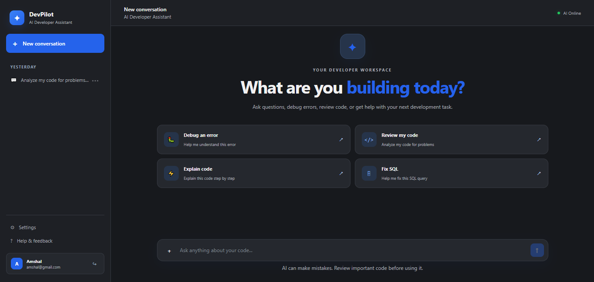
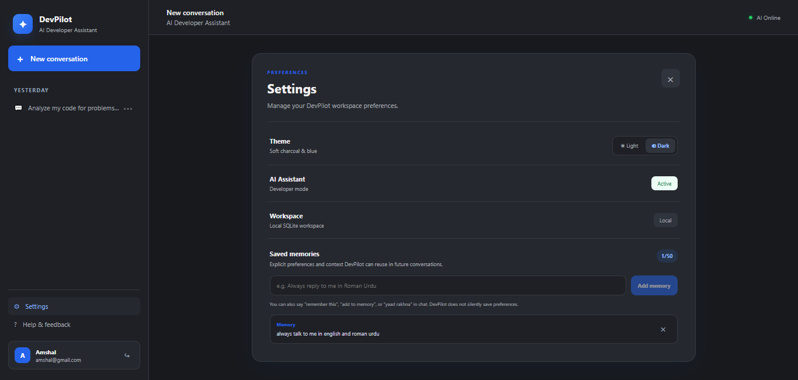
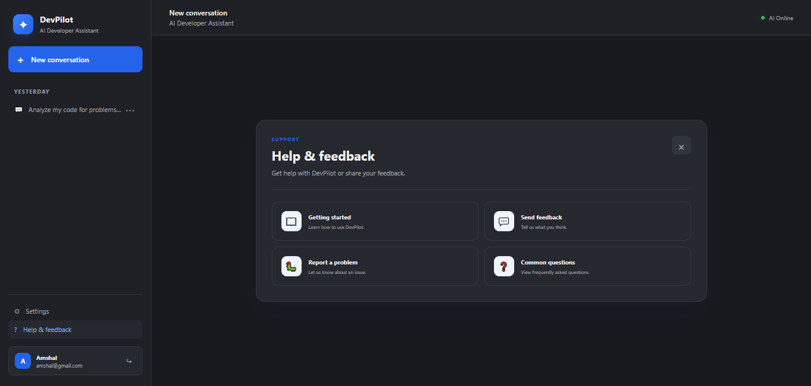

# DevPilot — AI Developer Assistant

DevPilot is a local-first developer workspace with a React chat interface and a FastAPI backend. It helps explain programming errors, review code, answer development questions, work with a user-provided text file or bounded project ZIP, and retain conversations and explicit memories per account.

## Features

- React + Vite frontend with responsive light/dark themes.
- FastAPI API with signup/login and JWT-protected user endpoints.
- Groq-powered responses with the configured Gemini fallback path.
- SQLite persistence for accounts, chats, messages, user settings, memories, and feedback.
- Conversation history search, rename/delete, and user-scoped historical recall.
- Markdown and code rendering, code-copy controls, and long-message expansion.
- Bounded ZIP inspection that avoids extracting archives, skips common secret/build/binary paths, and sanitizes context.
- Text-file attachment and scoped file-reading tools.
- Python execution is **disabled by default** because AST checks alone are not a security sandbox. Do not enable it for untrusted input without OS/container isolation.

## Architecture

- `frontend/src/App.jsx`: main React workspace, chat history, settings, and interactions.
- `backend/main.py`: FastAPI routes, authentication dependencies, chat orchestration, file endpoints, settings, memory, and feedback APIs.
- `backend/agent.py`: model/provider calls and tool-calling loop.
- `backend/tools.py`: tool registry and bounded code/file/documentation helpers.
- `backend/auth.py`: password hashing and JWT handling.
- `backend/database.py` / `backend/models.py`: SQLAlchemy engine, sessions, and SQLite models.
- `backend/memory.py` / `backend/history_retrieval.py`: explicit memories and user-scoped prior-chat recall.
- `backend/project_zip.py`: safe, bounded project ZIP inspection and relevant-context selection.
- `backend/file_workspace.py`: upload filename checks and per-user/per-conversation active-file workspace.

## Requirements

- Python 3.10 or newer (use a version compatible with the installed FastAPI and provider packages).
- Node.js compatible with the Vite version in `frontend/package.json`.
- API keys for whichever model providers you intend to use.

## Local setup

### 1. Backend

From the project root, create and activate a virtual environment, then install the backend requirements:

```bash
python -m venv .venv
# Windows PowerShell
.venv\Scripts\Activate.ps1
# macOS/Linux: source .venv/bin/activate
pip install -r backend/requirements.txt
```

Create `backend/.env` or configure environment variables in the shell. Do not commit real API keys. Common settings include `GROQ_API_KEY`, the Gemini API key variable used by `backend/agent.py`, `JWT_SECRET_KEY`, and optional `WORKSPACE_ROOT`. Check `backend/agent.py` and `backend/auth.py` for the exact environment variable names used by this version. Use a long, random JWT secret outside development.

Start the backend from the `backend` directory so its local imports resolve:

```bash
cd backend
uvicorn main:app --reload
```

The API health endpoint is `http://127.0.0.1:8000/api/health`.

### 2. Frontend

In a second terminal:

```bash
cd frontend
npm install
npm run dev
```

Open the local URL printed by Vite (normally `http://localhost:5173`). The frontend API URL is configured in `frontend/src/App.jsx`; update it only if your backend uses a different local address.

## Typical use

1. Sign up with a unique username, email, and password.
2. Start a chat such as “Explain this Python traceback” or “Review this SQL query.”
3. Attach a supported text/code file when you want the assistant to inspect it.
4. Upload a project ZIP for bounded project-context analysis; do not include secrets in the archive.
5. Use Settings to change the theme and manage saved memories.
6. Use the conversation sidebar to reopen, search, rename, or delete saved chats.

## Testing

Frontend source regression tests (no browser required):

```bash
cd frontend
node --test ui_regression.test.mjs
npm run build
npm run lint
```

Backend syntax check from the project root:

```bash
python -m compileall -q backend
```

The frontend regression tests are source-level checks, not a replacement for browser-based end-to-end tests. Live model-provider behavior requires valid API keys and should be tested locally.

## Data and privacy

The application stores account, conversation, memory, settings, and feedback data in SQLite. Keep the database and `.env` files private, use strong credentials, and back up the database before upgrades. User-scoped API checks are intended to prevent cross-account access, but security-sensitive changes still need integration and adversarial tests.

## Limitations and safety

- Model answers can be incorrect; review generated code before running it.
- Provider quotas, latency, and availability depend on your API accounts.
- Python execution remains disabled by default until a real OS/container sandbox is implemented and reviewed.
- Do not expose the development server to the public internet. This project is intended to run locally; no deployment steps are included.
- Before treating this as production-ready, finish API integration tests, adversarial file tests, and a security review of request limits, CORS, secrets, and tool access.


## New Conversation


## Setting


## Help & Feedback
